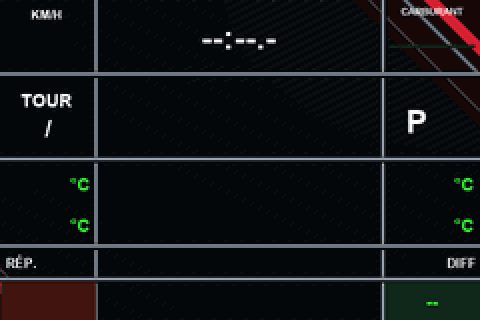

# F1L — Mises à jour de votre volant

**Version : R2F150**

Ce projet communautaire **non officiel** permet de mettre à jour certains volants **F1L / MVH**.

## 🔄 Vous possédez déjà F1L ?

Si votre volant dispose de la fonction de mise à jour Wi-Fi :

1. Connectez-le à Internet.
2. Ouvrez sa page Web, puis **MVH Custom**.
3. Choisissez **Rechercher une mise à jour** et suivez les instructions.

[Voir les versions et mises à jour disponibles](https://github.com/matthieumartin09/F1L-updates/releases)

Gardez le volant alimenté et arrêtez la télémétrie pendant la mise à jour.

## 📚 Bibliothèque de dashboards

Découvrez les dashboards F1L en accès libre. Chaque modèle dispose d'un aperçu, d'une description et d'un lien de téléchargement. Les prochains modèles seront ajoutés dans ce même catalogue.

| Aperçu | Dashboard et téléchargement |
|:---:|---|
|  | **F1 V2** — 3 pages : Course, Voiture et Moteur. **[Télécharger le dashboard (.f1l)](https://raw.githubusercontent.com/matthieumartin09/F1L-updates/main/F1_V2.f1l)** [Voir les 3 pages](DASHBOARDS.md#f1-v2) |

**[Voir tous les dashboards et leurs aperçus](DASHBOARDS.md)**

Pour installer un dashboard sur un volant compatible, utilisez **ADD DASHBOARD** depuis la page Web du volant et choisissez le fichier `.f1l`. Ce fichier n'est pas un firmware ; ne l'utilisez ni en flash USB ni comme mise à jour OTA.

*Les aperçus montrent les fonds graphiques du dashboard. Les valeurs dynamiques apparaissent pendant l'utilisation.*

## 🔒 Première installation — Accès réservé

Le programme de première installation est **distribué uniquement aux personnes autorisées**. Il n'est pas proposé en téléchargement libre sur cette page.

Si vous avez reçu ce programme directement, suivez **uniquement les instructions qui l'accompagnent**.

**Important :** une première installation avec une image complète peut effacer les réglages et dashboards personnels du volant. Effectuez une sauvegarde avant toute installation.

## ℹ️ À savoir

- Vérifiez la compatibilité de votre volant avant toute installation.
- Ne coupez pas l'alimentation pendant une mise à jour.
- Gardez un moyen de dépannage par USB en cas de problème.
- L'installation d'un **dashboard** et la mise à jour du **programme du volant** sont deux opérations différentes.

[Informations complémentaires et précautions](PUBLICATION.md)

---

*Projet communautaire non officiel, indépendant de MVH Studios.*
